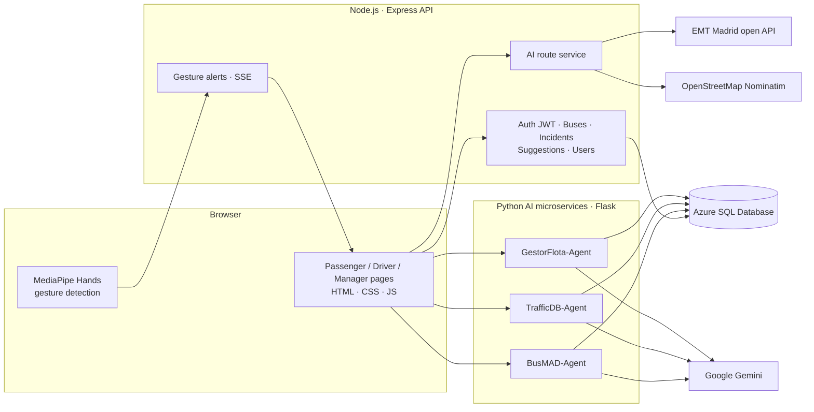

# 🚌 CityFlow Web

**Smart public-transport platform for Madrid with AI agents for passengers, drivers and fleet managers.**

CityFlow Web connects real-time bus data from the EMT Madrid open API with a cloud database and three
conversational **AI agents** that use tools to answer questions from live data. It also lets drivers raise
hands-free alerts with **hand gestures** detected by computer vision in the browser.

> Part of the [CityFlow](https://github.com/jorgee111/CityFlow) project · Universidad Europea de Madrid

---

## ✨ Features

| Role | What they get |
|---|---|
| **Passenger** | Live map of buses, line and stop search, AI route planner and a chat assistant (BusMAD-Agent) |
| **Driver** | Driver panel, incidents for their line through a chat assistant (TrafficDB-Agent) and hands-free alerts by hand gesture |
| **Fleet manager** | Dashboard of lines, buses and occupancy, incident and suggestion management, real-time gesture alerts and a fleet assistant (GestorFlota-Agent) |

## 🤖 AI agents

Three agents built with **[Agno](https://github.com/agno-agi/agno)** and **Google Gemini**, each exposed as a
Flask microservice and started together by `python/launcher_mp.py`:

| Agent | Port | For | Tools |
|---|---|---|---|
| **BusMAD-Agent** | 5000 | Passengers | `DBTrafficTool` + DuckDuckGo web search |
| **TrafficDB-Agent** | 5002 | Drivers | `DBTrafficTool`: incidents per line from Azure SQL |
| **GestorFlota-Agent** | 5003 | Fleet managers | `DBTrafficTool` (incidents and suggestions) + DuckDuckGo web search |

The agents are instructed to answer **only from what their tools return**, so the answers are grounded in the
real data instead of the model's own knowledge.

## 🧭 AI route planner

`POST /api/ai/route` turns two addresses into a bus route: it geocodes them with OpenStreetMap (Nominatim) and
combines them with **real-time bus and stop data from the EMT Madrid open API**, cached in memory (buses every
30 s, stops every 24 h).

## ✋ Gesture alerts for drivers

The driver panel runs **MediaPipe Hands** directly in the browser. A hand gesture in front of the camera
raises an alert that the server pushes to the manager's dashboard in real time with **Server-Sent Events**.

## 🏗️ Architecture



## 🛠️ Tech stack

- **Back end:** Node.js 18, Express, JWT authentication, bcrypt
- **AI:** Agno agents, Google Gemini, tool use, DuckDuckGo search, MediaPipe Hands
- **Data:** Azure SQL Database (`mssql`, `pyodbc`), EMT Madrid open API, OpenStreetMap
- **Front end:** HTML, CSS and vanilla JavaScript
- **Cloud:** Microsoft Azure (App Service + Azure SQL)

## 📁 Project structure

```
CityFlow-Web/
├── server/              Node.js API
│   ├── routes/          auth, buses, incidents, suggestions, users, gestures, ai
│   ├── services/        emtService (EMT Madrid API), aiRouteService
│   ├── middleware/      JWT authentication
│   └── db/              schema.sql and setup script
├── python/              AI agents (Flask + Agno + Gemini) and launcher
└── public/              web pages for each role
```

## 🚀 Getting started

**Requirements:** Node.js 18+, Python 3.10+, an Azure SQL database and a Gemini API key.

```bash
# 1. API and web
npm install
cp .env.example .env            # fill in the database and JWT values
npm run setup-db                # create the tables
npm run dev                     # http://localhost:3000

# 2. AI agents
cd python
pip install -r requirements.txt
cp .env.example .env            # fill in GEMINI_API_KEY and the database values
python launcher_mp.py           # starts the three agents
```

Environment variables (names only, never commit the values): `DB_SERVER`, `DB_NAME`, `DB_USER`,
`DB_PASSWORD`, `DB_PORT`, `JWT_SECRET`, `JWT_EXPIRES_IN`, `PORT`, `EMT_CLIENT_ID`, `EMT_PASSKEY`
(EMT Madrid open API) and `GEMINI_API_KEY`.

## 👤 Author

**Jorge de la Peña Jiménez** · Computer Science and Engineering, Universidad Europea de Madrid ·
[LinkedIn](https://www.linkedin.com/in/jorge-de-la-peña-jiménez-ab8610299) · [GitHub](https://github.com/jorgee111)

## 📄 License

© 2024–2026 Jorge de la Peña Jiménez. All rights reserved. See [LICENSE](LICENSE).
